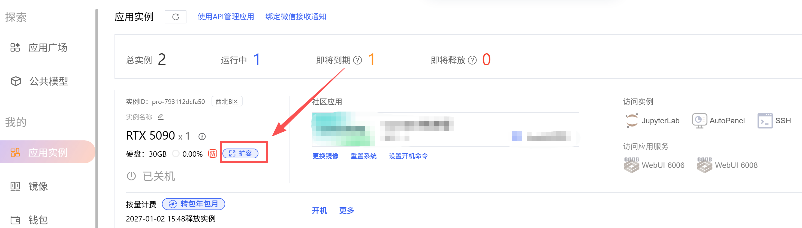
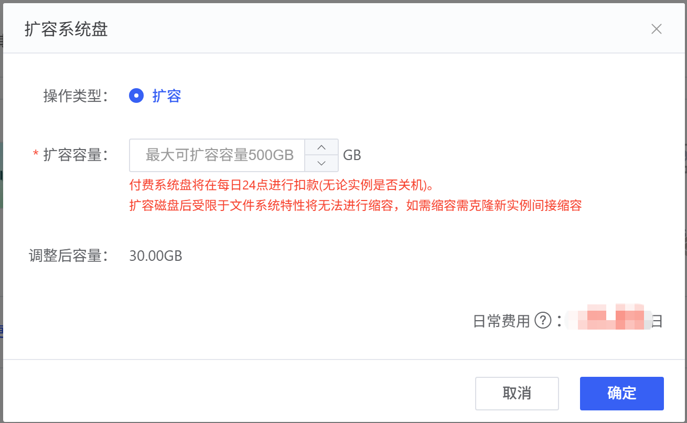

<Note>
实例系统盘无论实例是否开机运行均会在每日产生费用，扩容盘也会按每天最高扩容容量计费，详见[计费规则](/app/expense/price)。
</Note>

扩容缩容均需要在关机状态下进行。

## 扩容

点击「扩缩容」，然后在弹窗里设置扩容容量。

## 缩容

扩容磁盘后受限于文件系统特性将无法进行缩容，如需缩容需克隆新实例间接缩容。

比如：

实例扩容70G后共计100G，目前只使用60G，想要缩容40G。推荐做法：克隆一个新实例，新实例只扩容30G，克隆完成检查数据无误后释放源实例。

