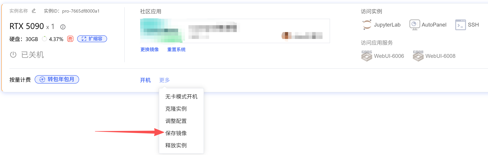
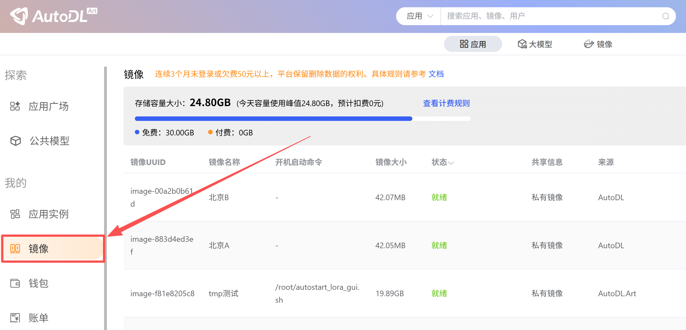
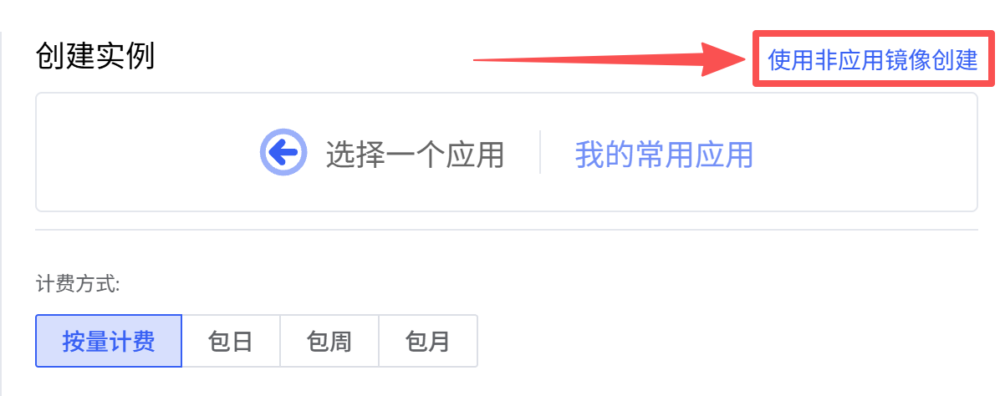
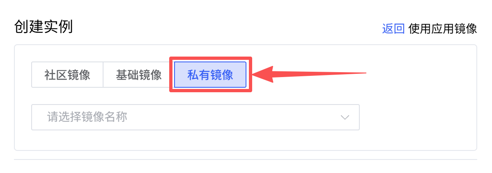
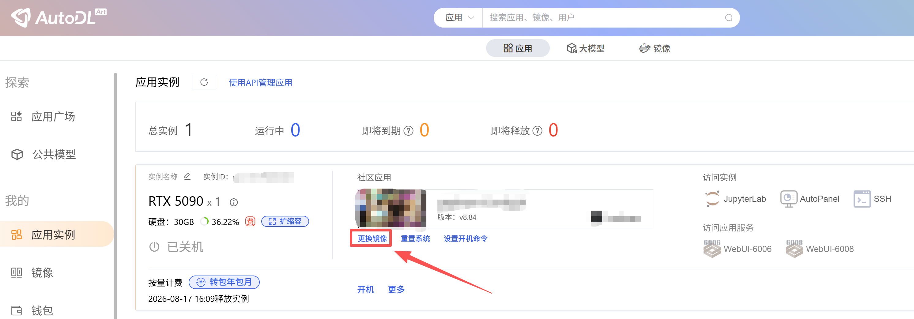
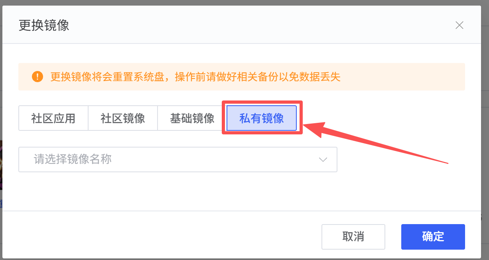
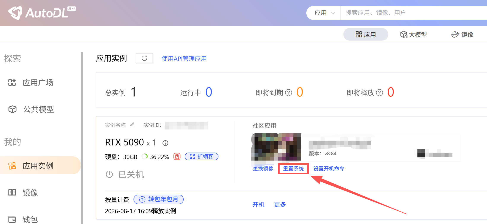
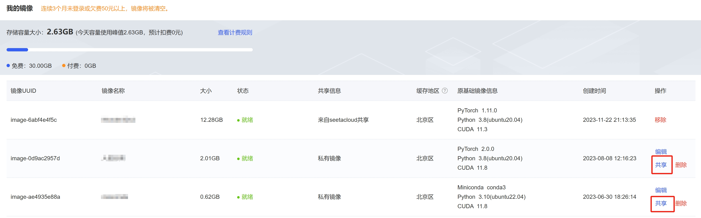
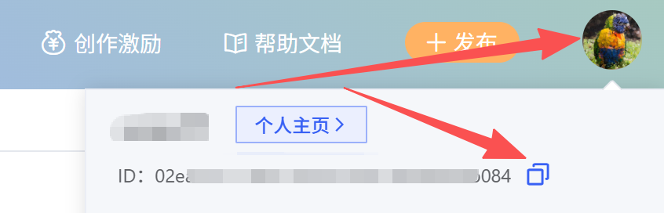

<Tip>当前AutoDL不支持导入外部镜像。</Tip>

如果您在一个实例中配置好了环境，在更换主机以及开新的实例时希望复用该环境，以及长期留存该环境以备日后使用，那么保存镜像将是最好的选择。此外还**支持共享镜像给其他用户**。

## 保存镜像

将实例关机后，在更多操作中点击「保存镜像」，则可以将该实例的整个系统盘保存下来（了解什么是[系统盘](/app/instance/env#实例中的目录))

保存镜像后请在「应用」->「镜像」菜单中查看。 
 

## 加载镜像

租用新实例或者已有实例选择更换镜像时，选择自己保存的私有镜像，这样即可恢复原来实例系统盘中的所有内容。

## 更换镜像

将实例关机后，在更多操作中点击更换镜像。

<Warning>更换镜像将会重置系统盘（了解什么是[系统盘](/app/instance/env#实例中的目录))，操作前请做好相关备份以免数据丢失。此外该实例无数据盘(/root/autodl-tmp 仅为普通目录，非容器实例数据盘)，但在更换镜像时会保留/root/autodl-tmp目录下数据</Warning>

## 重置系统

重置系统或更换镜像，都能将系统恢复至初始状态。重置系统只是恢复应用或镜像的初始状态，并非清空系统盘的所有数据，因此系统盘仍然会有占用。

<Warning>重置系统将清空系统盘数据系统盘将恢复为您选择的应用或镜像的初始状态，请谨慎操作。此外该实例无数据盘(/root/autodl-tmp 仅为普通目录，非容器实例数据盘)，但在重置系统或更换镜像时会保留/root/autodl-tmp目录下数据</Warning>

## 共享镜像

保存镜像后可以共享给其他用户使用。操作入口: www.autodl.com ->「控制台」->「镜像」在操作中点击「共享」，共享给指定的用户。

对方用户ID可在页头用户名下拉窗口下获取。

