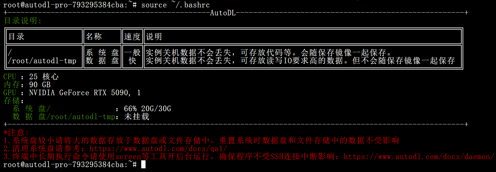
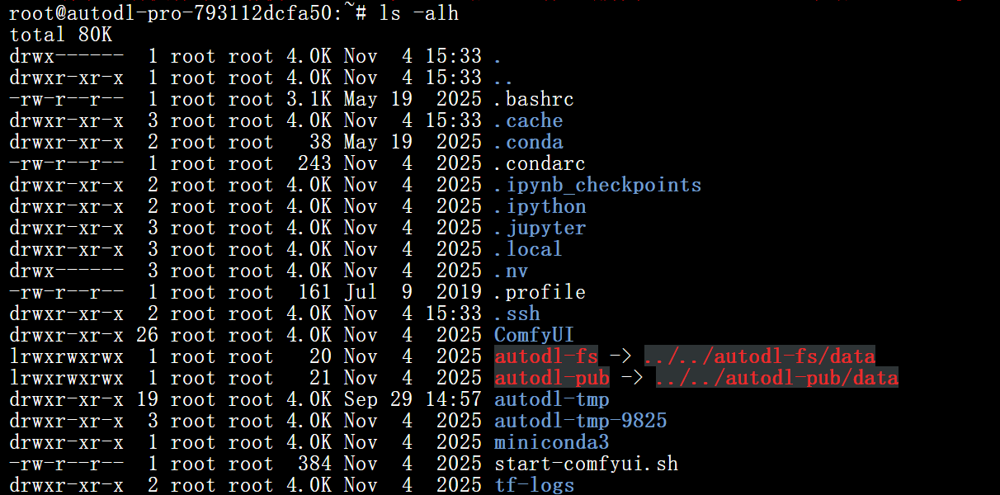
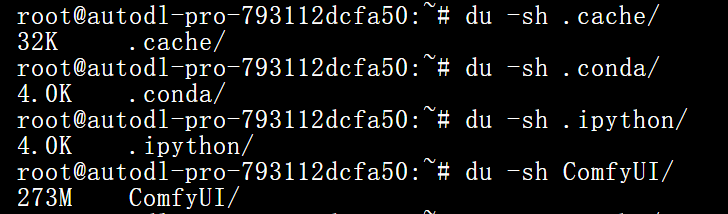
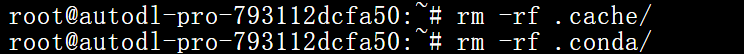

<Danger>注意使用 rm 命令删除文件无法恢复。</Danger>

## 如何查看系统盘空间？

在实例终端运行以下命令，查看系统盘总量和剩余空间：

```bash
source ~/.bashrc
```




应用实例的系统盘默认 30 GB。根目录 `/` 下的大部分文件和目录都占用系统盘，包括软件依赖、Python 环境、代码和下载文件。`/root/autodl-tmp` 在应用实例中只是普通目录，并不是独立数据盘，也会占用系统盘空间。公共模型目录 `/.autodl/` 为只读目录，不计入系统盘。

更多目录说明参见[实例中的目录](/app/instance/env#实例中的目录)。

## 如何清理系统盘？

### 使用工具 

可以先在控制台的「应用实例」→「AutoPanel」→「实用工具」中使用**清理系统盘**。该工具会清理部分缓存和回收站内容。

### 手动清理

如果空间仍不足，可以试试手动清理。

以下两个是可以直接删除，不影响系统运行的目录，所以首先直接删除。如果未能释放空间，继续查看下文

```bash
du -sh /root/miniconda3/pkgs/ && rm -rf /root/miniconda3/pkgs/*      # conda的历史包
du -sh /root/.local/share/Trash && rm -rf /root/.local/share/Trash   # jupyterlab的回收站
```

以下目录是可能占用较大空间，但需要您根据实际情况清理的目录：

```bash
du -sh /tmp/         #查看/tmp占用的空间大小
du -sh /root/.cache  #查看/root/.cache占用的空间大小
```

如果仍需继续清理，继续查看下文。

#### 检查文件大小

使用`ls -alh`命令来查看，比如下方的`.bashrc`、`.profile`文件的大小。但是看到的文件夹大小仅仅是文件夹本身大小，并非文件夹下所有文件的大小。




#### 检查文件夹大小

使用`du -sh xxx`命令，递归统计该文件夹下所有文件的大小



#### 删除

使用`rm -rf xxx`来删除文件/文件夹，释放空间



## 如何扩容系统盘？可以缩容吗？

扩容或缩容前都需要先关机。在实例操作菜单中点击「扩容」并设置容量即可扩容。系统盘扩容会产生额外费用，计费规则参见[应用实例计费](/app/expense/price#系统盘计费)。

扩容后受文件系统限制，通常不能直接缩小系统盘。如确需使用更小容量，可克隆到新实例并选择较小的系统盘容量；确认新实例数据完整后，再决定是否释放旧实例。释放实例会清空数据且无法恢复。

详情参见[系统盘扩容与缩容](/app/data/scale)。
