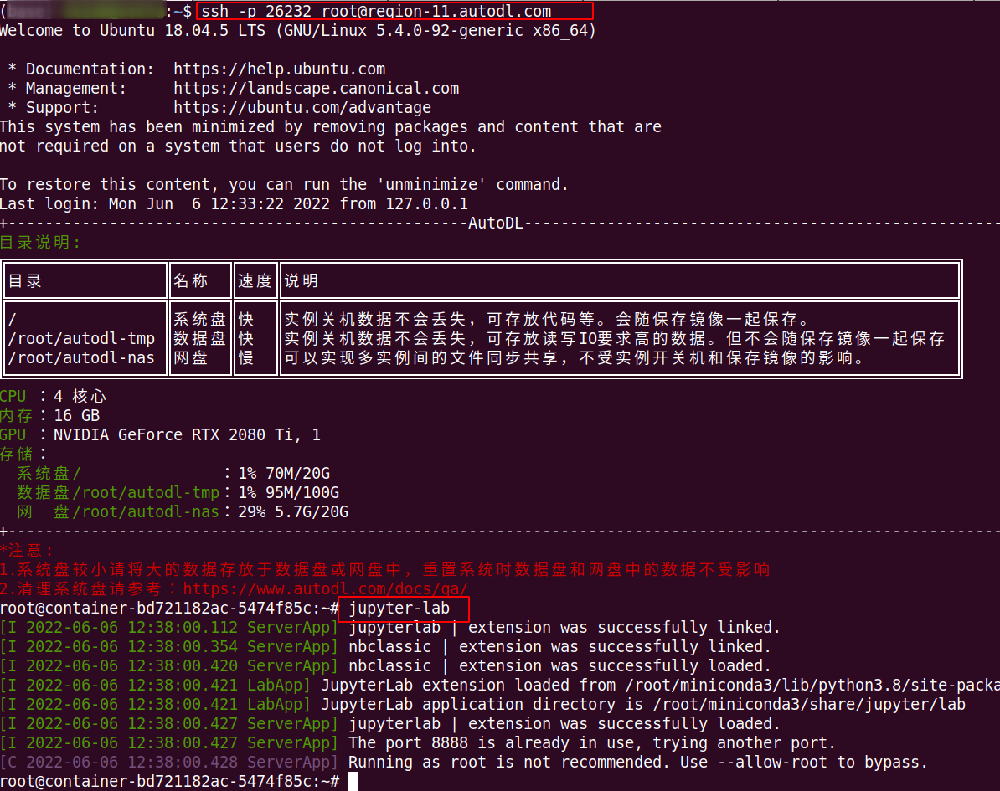
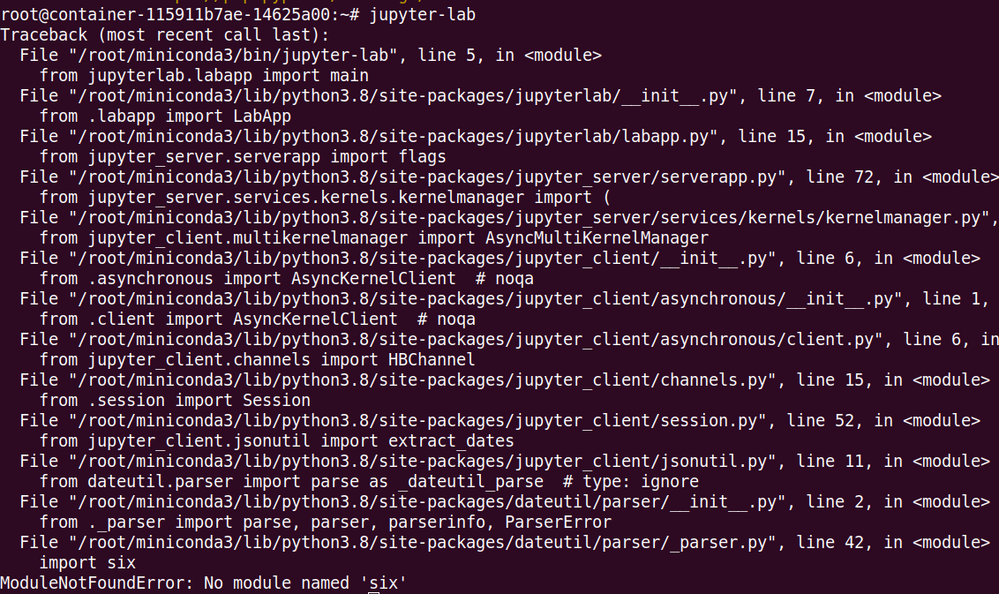
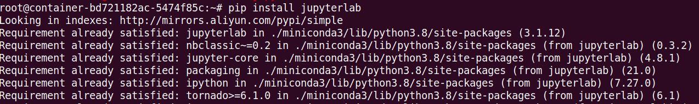
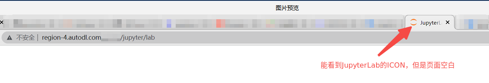
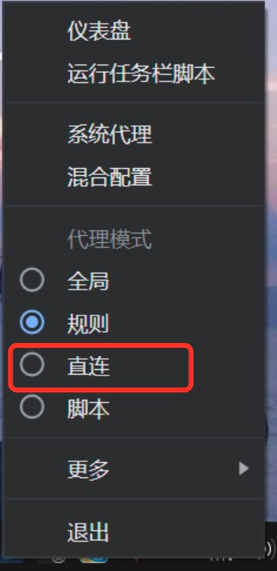
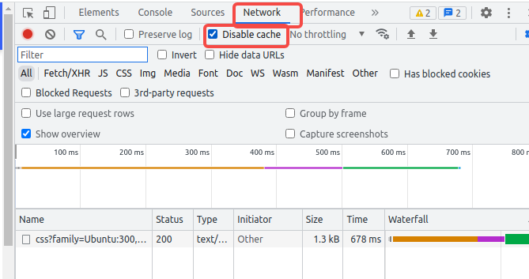

## 开机后服务页面显示 404 怎么办？

### 稍等重试

实例开机后，应用服务可能还在启动。先等待片刻并刷新页面。

### 查看教程

如果仍然显示 404，请查看应用详情中的使用教程，确认是否需要额外启动服务或执行初始化步骤。

同时确认实例处于运行状态，并从实例页面点击该应用对应的服务入口。不同应用可能使用不同入口，请按应用教程选择 6006 或 6008。

## 服务页面空白或一直加载怎么办？

### 等待加载

部分 Web 应用首次加载资源较多，页面可能需要等待一段时间。

### 排查网络

如果实例状态正常、服务进程也在运行，但服务页面一直空白或加载中，可以参考下面方法检查网络：

1. 如果开了FQ梯子(VPN)，关闭梯子试试。
2. 如果使用校园网，切换到非校园网络试试，部分校园网会限制访问所需端口。
3. 使用不同供应商的网络试试，比如使用手机热点，试试联通、移动、电信网络。
4. 使用其他地区机器试试。
5. 稍等一会再重试。

### 更换浏览器/设备

更换浏览器或电脑。

## JupyterLab 无法打开怎么办？

先确认实例处于运行状态，并从实例页面点击 JupyterLab 入口。

### JupyterLab 服务无法启动

安装或升级 Python 依赖时，可能连带升级、降级 JupyterLab 所需的依赖，导致服务无法启动。可通过 [SSH](/app/instance/ssh) 登录实例，在终端运行 `jupyter-lab` 查看是否有启动错误。

（如果是windows用户，可以使用cmd或powershell进行ssh登录，**但是可能无法正常粘贴密码，需手动输入密码**）



若命令有如下类似报错，或确认 JupyterLab 依赖已损坏，可在 AutoPanel 的「实用工具」中使用**重装 JupyterLab**，然后重新打开页面。



手动重装命令：

```bash
pip uninstall jupyterlab // 卸载当前的jupyterla
pip install jupyterlab  // 重新安装
```




如果 `pip` 命令不存在，那么先执行 `conda install pip`，如果 `conda` 命令不存在，说明您可能删除了 miniconda，可考虑[重置系统](/app/instance/image)。重置前请备份系统盘数据；`/root/autodl-tmp` 在重置或更换镜像时会保留，但仍建议先核对重要文件。

### 页面空白或一直加载（网络问题）

若页面能显示 JupyterLab 图标但内容空白或一直加载，优先按下方的网络问题排查，可能由 VPN 代理、浏览器缓存或网络策略导致。



1. 暂时关闭 VPN 后刷新页面。
2. 如果关闭了VPN，依然无法访问，那么需要打开VPN，将VPN的模式开为直连模式。VPN没有直连模式的，选择PAC模式，请勿选择全局模式（个别VPN即使关闭依然会对系统的网络造成影响），下图为Mac某款VPN和Windows某款VPN的设置：


3. 以上配置了VPN直连模式后，如果仍然无法打开，那么在JupyterLab网页按[F12] -> 选择Network -> 勾选Disable cache，勾选后刷新网页。如果还不行更换浏览器

4. 如果当前使用校园网，切换到手机热点或其他网络。部分校园网会限制访问所需端口。

如果以上步骤仍无法解决，请联系客服并提供实例 ID、以及页面报错或终端输出，便于进一步排查。


