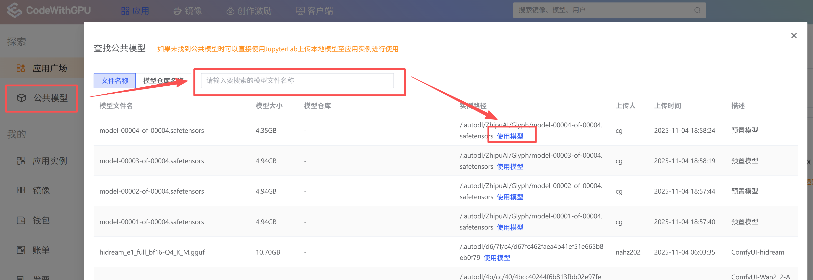
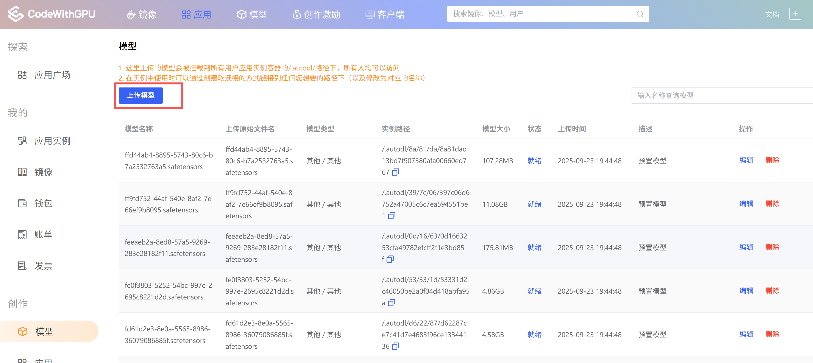
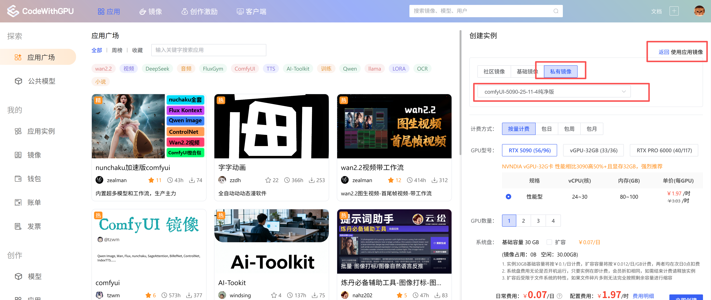
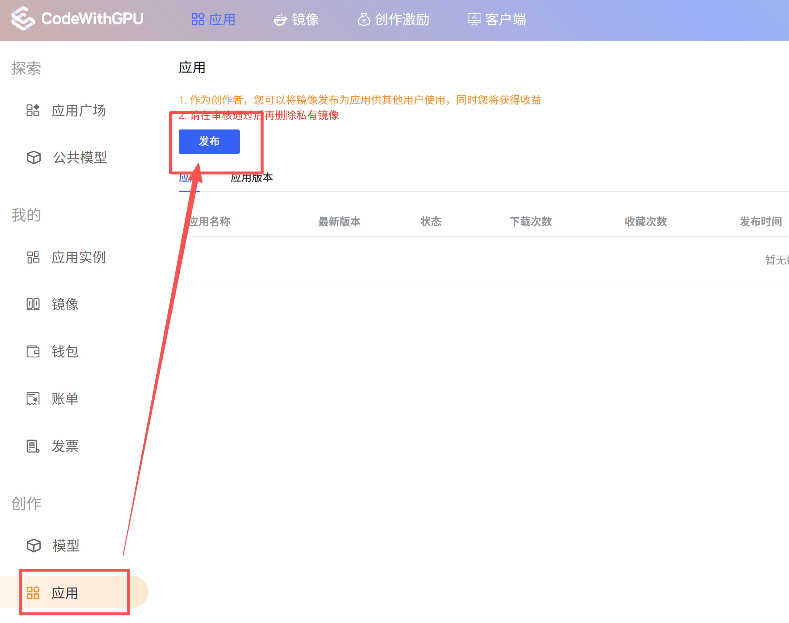

社区应用发布的基本流程是：准备模型和运行环境、创建并测试实例、保存实例镜像，再将镜像提交为应用。发布后，其他用户可以从应用广场创建实例使用。

## 发布前准备

开始前，请准备好需要发布的应用代码、启动方式和运行说明，并确认实例可以正常运行。若应用依赖模型文件，先确认模型的来源、许可和存放方式。

## 准备模型

### 优先复用公共模型

在「模型」的公共模型列表中搜索应用需要的模型。找到后，点击「使用模型」并按照页面提示在应用实例中引用。这样通常无需重复上传已有模型。

<Frame caption="在公共模型列表中搜索模型，并使用已有模型">
  
</Frame>

如果没有找到需要的模型，可以从模型页面上传。上传后，请按照平台提供的模型路径在应用中引用；截图中的模型路径位于应用实例容器的 `/.autodl/` 下。如果项目要求模型位于其他目录，可以按需创建软链接。更多操作请参考[使用模型](/app/data/use-model)。

<Frame caption="上传并管理自己的模型">
  
</Frame>

## 创建并测试实例

### 创建应用实例

进入「应用广场」，选择合适的应用或镜像并创建实例。根据项目要求选择社区镜像、基础镜像或私有镜像，并配置所需的 GPU、显存和磁盘资源。

<Frame caption="创建实例时选择镜像并配置机器资源">
  
</Frame>

<Note>
截图中的机型和价格仅用于说明操作位置。可选资源和计费单价以创建页面的实时显示为准。
</Note>

### 配置并验证应用

在实例中安装或调整项目依赖，配置模型路径、启动命令和服务端口。发布前至少验证一次完整流程，确认应用能启动、模型可以读取、服务可以按说明访问，并记录用户需要执行的操作。

发布说明中应写清楚应用功能、推荐资源、启动方式、访问入口，以及首次运行时是否需要下载额外文件。不要把 API Key、密码或个人数据写入镜像或公开说明。

## 保存镜像

确认应用配置和文件已保存后，正常关闭实例。进入实例的「更多操作」，选择「保存镜像」，将当前系统盘保存为私有镜像。保存镜像的详细说明请查看[镜像操作](/app/instance/image)。

## 提交应用发布

1. 在控制台进入「创作」下的「应用」，打开「应用」页面并点击「发布」。
2. 按页面要求填写应用信息和使用说明，并选择刚才保存的私有镜像。
3. 检查信息和镜像版本后提交审核。
4. 在审核通过前保留该私有镜像；审核通过后，再按需要管理或清理私有镜像。

<Frame caption="在创作中心提交应用发布">
  
</Frame>

审核通过后，可以在应用广场查看已发布的应用。若审核未通过，请根据平台反馈修改应用信息或镜像后重新提交。
