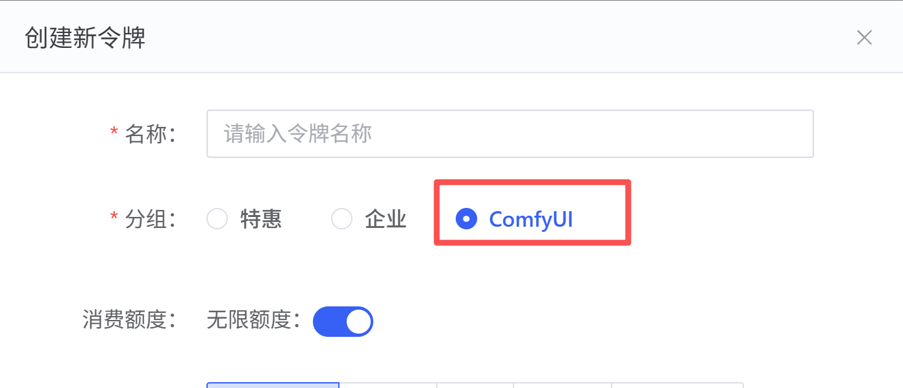
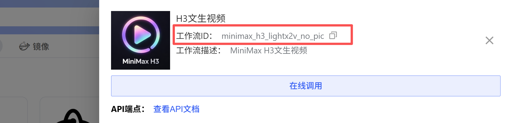
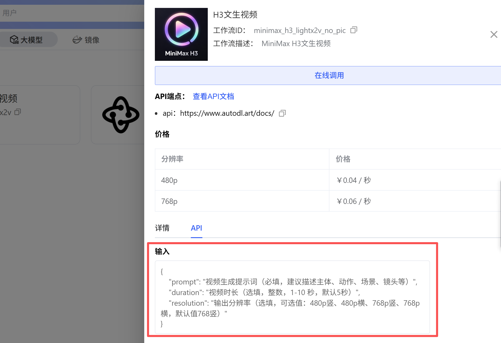
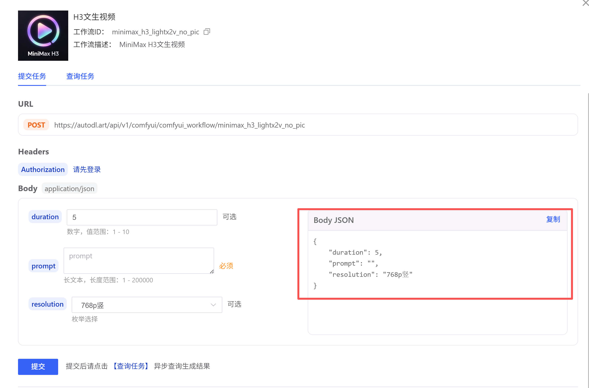

ComfyUI API页面的不同工作流的接入流程和整体API参数基本一致，主要区别在于：工作流ID不同、提交任务时与工作流相关的入参会有差异。以下以MiniMax H3文生图工作流为例说明：

调用分为两步：提交任务并取得 `task_id`，再使用该 ID 查询任务状态和结果。

<Note>不同工作流的请求参数和生成结果类型可能不同。请在工作流详情或「在线调用」弹窗中查看该工作流的 ID、参数名称、类型和取值范围。</Note>

## 调用准备

1. 在 [令牌管理](https://www.autodl.art/large-model/tokens) 中创建令牌，分组选择 **ComfyUI**。

2. 在 ComfyUI API 页面选择需要调用的工作流，记录工作流 ID。

3. 查看该工作流对应的请求参数。不要直接将其他工作流的示例参数用于当前工作流。

令牌通过 Headers 请求头传入：

```http
Authorization: YOUR_TOKEN
Content-Type: application/json
```

## 第一步：提交任务

向工作流接口发送 `POST` 请求：

```text
https://autodl.art/api/v1/comfyui/comfyui_workflow/{workflow_id}
```

将 `{workflow_id}` 替换为工作流 ID，并按该工作流的参数说明填写 JSON 请求体。例如：

```bash
curl -X POST \
  "https://autodl.art/api/v1/comfyui/comfyui_workflow/{workflow_id}" \
  -H "Authorization: YOUR_TOKEN" \
  -H "Content-Type: application/json" \
  -d '{
    "prompt": "生成一只小猫在云端漫步",
    "duration": 1,
    "resolution": "480p竖"
  }'
```

上面的字段仅用于示意，实际参数以所选工作流弹窗展示的 API 请求参数为准。
下图展示了工作流详情中的 API 参数说明。图片仅作界面示例，具体字段以你选择的工作流当前页面为准。





成功提交后，响应中的 `data.task_id` 用于查询任务：

```json
{
  "code": "Success",
  "data": {
    "task_id": "2a25da1d-39ad-495c-8dac-bae8e8f6b1a1",
    "workflow": "H3文生视频",
    "status": "QUEUED",
    "client_id": "8c93a8000ef50e05d5314014756bd62c",
    "message": "工作流任务已提交",
    "created_at": "2026-08-18T11:33:02.456421825+08:00"
  },
  "msg": "",
  "request_id": "8c93a8000ef50e05d5314014756bd62c"
}
```

## 第二步：查询任务

向结果接口发送 `GET` 请求：

```text
https://autodl.art/api/v1/comfyui/comfyui_workflow/result/{task_id}
```

将 `{task_id}` 替换为提交任务时返回的 ID。查询请求使用相同的鉴权请求头，不需要请求体：

```bash
curl -X GET \
  "https://autodl.art/api/v1/comfyui/comfyui_workflow/result/{task_id}" \
  -H "Authorization: YOUR_TOKEN"
```
Response Body

```json
{
  "code": "Success",
  "data": {
    "task_id": "2a25da1d-39ad-495c-8dac-bae8e8f6b1a1",
    "workflow": "H3文生视频",
    "status": "QUEUED",
    "client_id": "8c93a8000ef50e05d5314014756bd62c",
    "message": "工作流任务已提交",
    "created_at": "2026-08-18T11:33:02.456421825+08:00"
  },
  "msg": "",
  "request_id": "8c93a8000ef50e05d5314014756bd62c"
}
```

`data.status` 表示任务状态：`QUEUED` 为排队中，`RUNNING` 为执行中，`SUCCESS` 为成功，`FAILED` 为失败。任务尚未结束时应稍后再次查询；成功后从 `data.results` 获取图片、视频等结果资源 URL。失败时请查看响应中的错误信息并检查工作流参数。

<Warning>结果资源 URL 有效期为 24 小时。任务成功后请尽快下载并保存结果，过期后可能无法访问。请勿将 Token 提交到代码仓库或公开分享。</Warning>


## Python 示例

安装依赖：

```bash
pip install requests
```

将 `YOUR_TOKEN`、`WORKFLOW_ID` 和请求参数替换为自己的值。示例会轮询任务状态，直到成功或失败：

```python
import json
import time

import requests

headers = {"Authorization": "***请替换成自己的Token, 获取地址：https://autodl.art/large-model/tokens ***", "Content-Type": "application/json"}
workflow_id = "minimax_h3_lightx2v_no_pic"  # 这里用的H3文生图工作流
create_task_url = f"https://autodl.art/api/v1/comfyui/comfyui_workflow/{workflow_id}"
query_task_url = "https://autodl.art/api/v1/comfyui/comfyui_workflow/result/{task_id}"
# 这里请填写对应工作流的请求参数，可在网页端点击工作流的弹窗中查看API请求参数
create_task_body = {
    "prompt": "生成一直小猫咪在云端漫步",
    "duration": 1,
    "resolution": "480p竖"
}


def create_task():
    response = requests.post(create_task_url, json=create_task_body, headers=headers)
    print(f"提交任务返回task的Body：{response.content.decode()}")
    json_response = json.loads(response.content.decode())
    task_id = json_response['data']['task_id']
    return task_id


def query_task_result(task_id):
    q_url = query_task_url.format(task_id=task_id)
    while True:
        response = requests.get(q_url, headers=headers)
        # print(f"查询任务返回task的Body：{response.content.decode()}")
        json_response = json.loads(response.content.decode())
        data = json_response['data']
        print(f'任务状态：{data["status"]} 耗时：{data["duration"]}秒')
        if data["status"] == "SUCCESS":
            print(f'任务执行成功，推理结果：{data["results"]}')
            return
        elif data["status"] == "FAILED":
            print(f'任务执行失败')
            return
        time.sleep(1)


if __name__ == '__main__':
    _task_id = create_task()
    assert _task_id, "task_id为空"
    query_task_result(_task_id)
```
