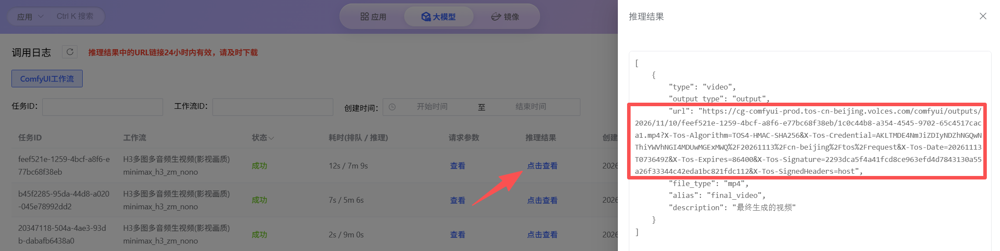
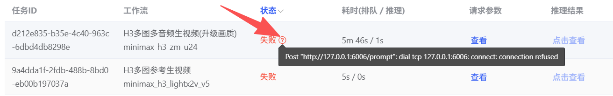

ComfyUI API 请求提交后，可以在 [AutoDL Art 调用日志](https://www.autodl.art/large-model/call-logs) 页面查看任务状态、请求参数、推理结果或失败原因。请登录发起调用的 AutoDL Art 账号，并切换到 **ComfyUI 工作流**记录进行查询。

## 查看并保存推理结果

找到状态为成功的任务，在「推理结果」列点击**点击查看**。在结果面板中找到对应文件的 `url` 字段，复制完整链接并粘贴到浏览器地址栏，即可打开或下载生成文件。

复制时请确保包含 URL 后面的全部查询参数。该链接为临时签名地址，有效期为 24 小时；建议打开后尽快下载并保存文件，不要将链接公开分享。

## 查看任务失败原因

如果任务状态显示失败，点击状态旁的问号图标查看错误详情。错误信息通常可以帮助判断是工作流服务、请求参数还是任务执行过程出现问题。

排查时可以依次检查：

- 工作流 ID 是否正确，提交的必填参数、参数类型及可选值是否符合该工作流说明。
- 根据错误详情检查请求参数或任务执行状态；通过程序调用时，可使用 [API 查询接口](/comfyui/api/api)核对任务状态和 `results` 字段。
- 如果错误原因已修正，可重新提交任务。重试前先确认原任务已失败，避免重复提交造成多次调用。

如果无法根据错误详情解决问题，请联系 AutoDL 客服，并提供任务 ID、工作流 ID、发生时间及错误信息。

