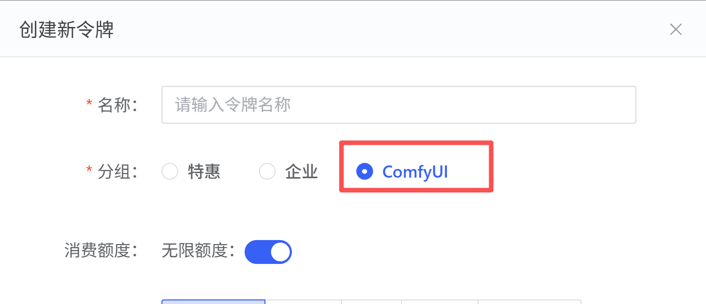
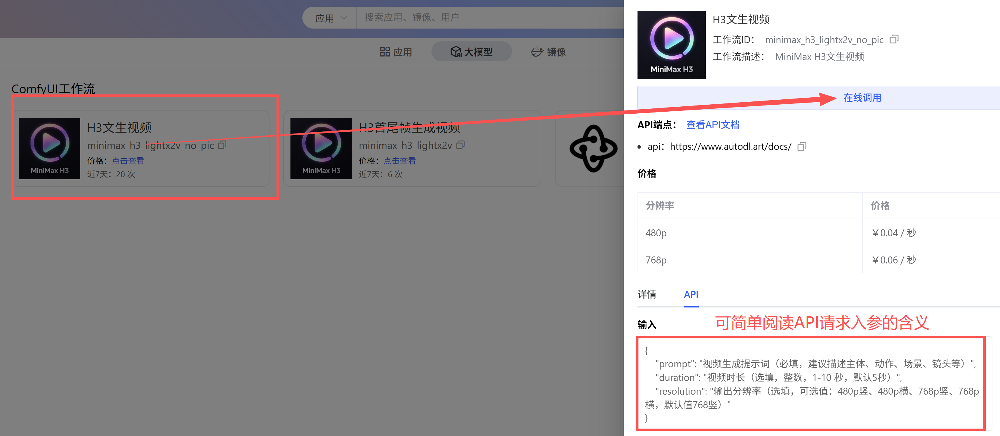
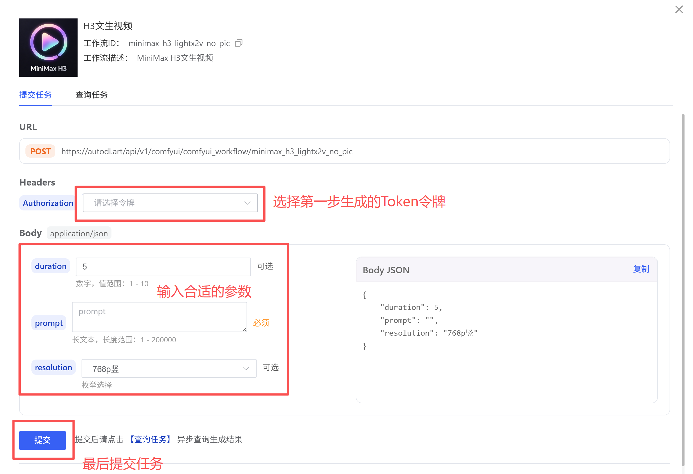
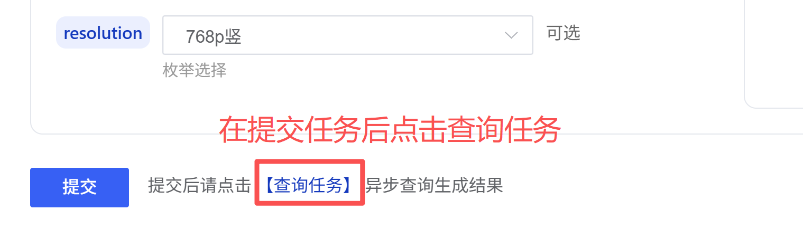
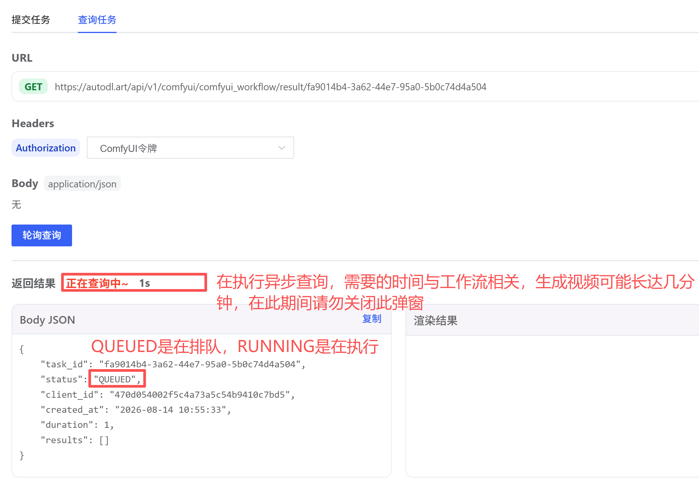

本页介绍如何先在网页中在线调用 ComfyUI 工作流。确认工作流和参数符合预期后，可以再通过 [API 调用文档](/comfyui/api/api) 接入自己的程序。

## 使用前准备

登录 [AutoDL Art](https://www.autodl.art/)，进入[令牌管理](https://www.autodl.art/large-model/tokens)创建 Token，并将分组设为 **ComfyUI**。如果已有可用的 ComfyUI Token，可以跳过此步骤。

<Warning>Token 等同于账号凭证，请勿分享或粘贴到公开页面。若怀疑泄露，请及时在令牌管理中禁用或删除并重新创建。</Warning>

## 第一步：选择工作流

进入 ComfyUI API 工作流列表，选择目标工作流，在详情面板中点击「在线调用」。确认工作流名称和说明，避免选错工作流。

## 第二步：选择 Token、填写参数并提交

在弹窗中选择 ComfyUI Token，按照字段提示填写必填参数；可选参数可按需调整。提交前检查右侧 Body JSON，确认参数和值符合工作流要求，然后点击「提交」。参数含义和可选值以当前工作流页面为准。

## 第三步：查询任务并保存结果

任务提交后，切换到「查询任务」查看进度。任务可能处于排队或执行状态，处理时长取决于工作流；查询期间保持弹窗打开。任务完成后及时下载并保存结果。

在线调用会先提交任务，再异步查询结果。关闭弹窗可能导致当前页面无法继续查询刚提交的任务；如果已经关闭，请前往[调用日志](/comfyui/api/log)排查请求记录，或在程序中按 [API 文档](/comfyui/api/api) 使用任务 ID 查询。

<Note>不同工作流的输入字段、参数范围和输出类型可能不同，请以工作流弹窗中展示的参数说明为准。API 返回的结果 URL 有效期为 24 小时，请及时下载保存。Token 是账号凭证，请勿公开分享。</Note>
