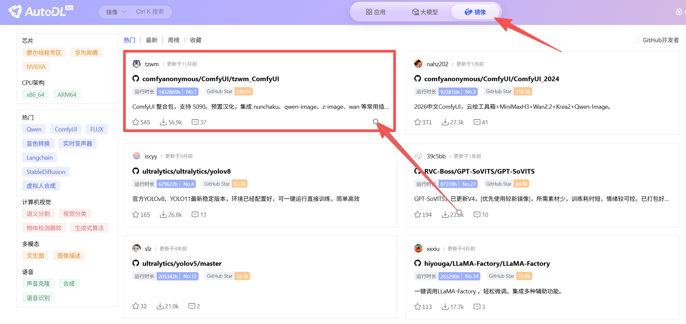
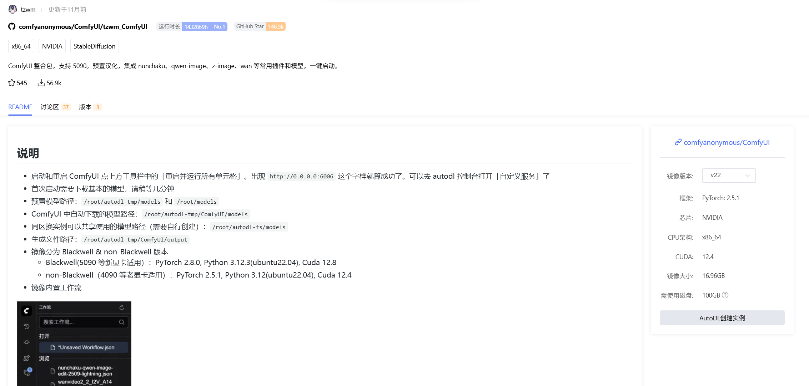
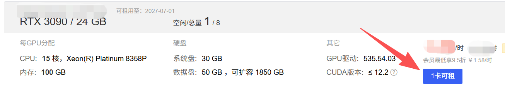
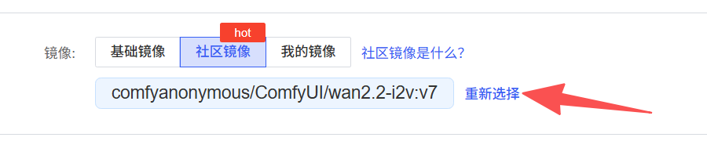
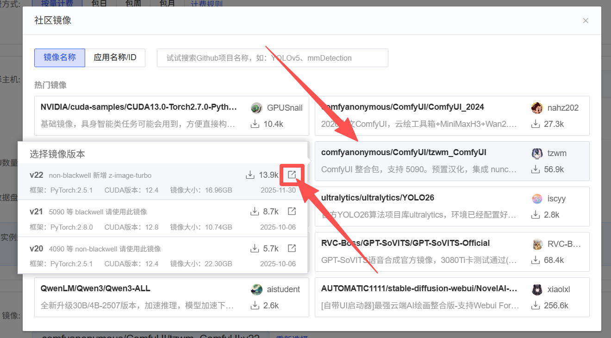
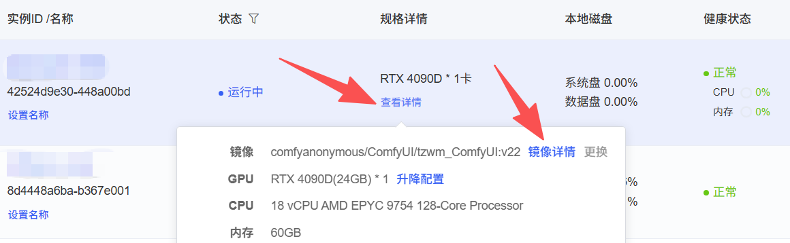
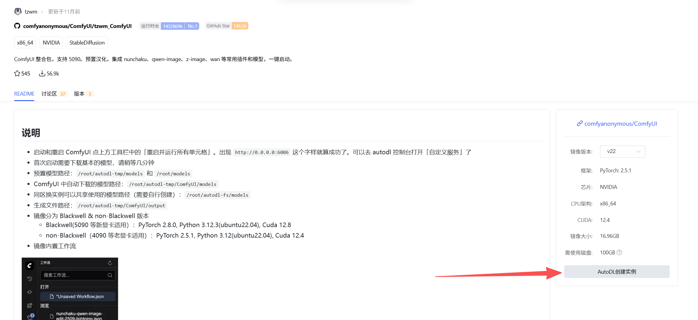

你可以使用其他用户在 AutoDL.art 上公开分享的镜像，在 AutoDL 机器上创建自己的运行实例。

<Note>
镜像是预先打包的运行环境，不是正在运行的实例。使用镜像仍需选择兼容的机器并创建实例。
</Note>

## Step 1: 查找镜像

镜像使用前都需要阅读作者提供的 README（说明文档）重点确认：

- 镜像名称、版本和制作者说明是否符合预期。
- 项目对 CPU 或 GPU、显存、CUDA 等环境的要求。
- 是否需要额外的数据盘、模型文件、启动命令或端口配置。

### 从 AutoDL.art 查看

打开[AutoDL.art](https://www.autodl.art/image) ->「镜像」页面，查找到自己需要的镜像，点击进入即可查看镜像详情。

### 从 AutoDL.com 查看

#### 还未创建实例

登录 [AutoDL.com](https://www.autodl.com/) ->「算力市场」-> 「租用实例」

选择「社区镜像」-> 「重新选择」

选择镜像后点击进入版本列表，点击右侧按钮，即可跳转到镜像详情

#### 已经创建实例

登录 [AutoDL.com](https://www.autodl.com/) ->「控制台」-> 「容器实例」->「查看详情」-> 「镜像详情」，即可跳转到镜像详情

## Step 2: 选择机器并创建实例

根据镜像的硬件和软件要求选择机器配置。在创建实例时，选择需要的社区镜像。然后按页面提示完成配置并创建实例。

也可从[AutoDL.art](https://www.autodl.art/image)镜像详情页右侧直接创建实例，镜像会默认选中。

<Tip>
选择 GPU 镜像时，先核对镜像说明中的 GPU 型号、显存和 CUDA 要求，避免创建后发现硬件或软件环境不兼容。
</Tip>

## Step 3: 启动并验证项目

等待实例创建完成后，按照镜像作者提供的说明进入实例并启动项目。镜像不会在启动时自动运行服务，请执行作者文档中提供的启动命令。

根据项目说明查看运行日志或访问对应服务，确认程序正常启动。首次运行时，项目可能还需要下载模型文件或其他资源，请留意日志和作者说明。

