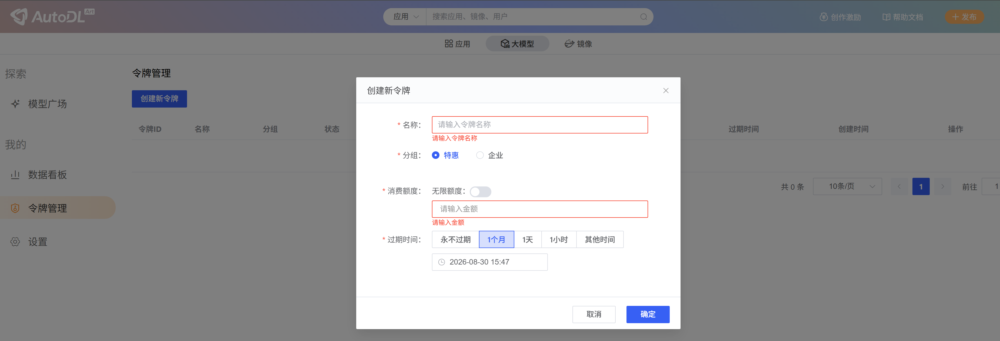
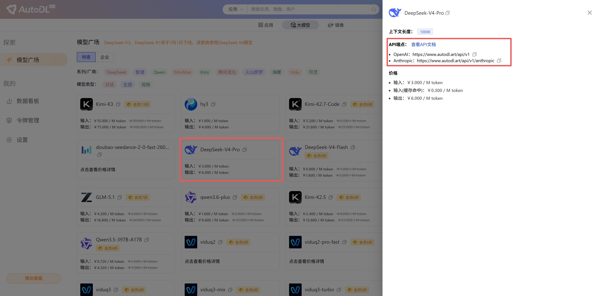
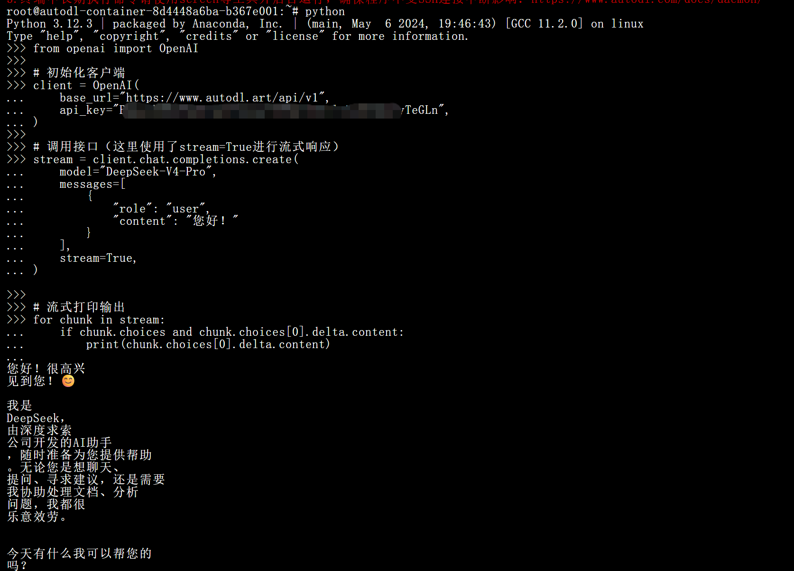

## 3步调通大模型API

### Step 1: 创建令牌

在「大模型」-> 「令牌管理」里创建一个令牌。

<Tip>建议设置消费额度和过期时间。</Tip>



### Step 2: 选择模型

在「大模型」-> 「模型广场」里选择使用的模型，获取API端点和模型名称。

<Tip>注意这里使用`DeepSeek-V4-Pro`的`OpenAI`端点进行演示。</Tip>



### Step 3: 开始调用 

使用下面python代码直接调用，或者使用工具调用，详见[客户端/开发工具]章节。

```Python
# 如果没有安装OpenAI Python SDK，可使用命令安装：pip install OpenAI

from openai import OpenAI

# 初始化客户端
client = OpenAI(
    base_url="https://www.autodl.art/api/v1",
    api_key="YOUR_API_KEY",
)

# 调用接口（这里使用了stream=True进行流式响应）
stream = client.chat.completions.create(
    model="DeepSeek-V4-Pro",
    messages=[
        {
            "role": "user",
            "content": "您好！"
        }
    ],
    stream=True,
)

# 流式打印输出
for chunk in stream:
    if chunk.choices and chunk.choices[0].delta.content:
        print(chunk.choices[0].delta.content)
```



