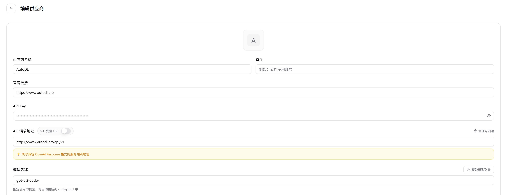

CC Switch 是一款用于管理 AI 编程工具配置的桌面应用。通过 CC Switch，你可以保存多个服务商配置，并在 Claude Code、Codex 等工具之间快速切换。

## 前置准备

1. 前往 [CC Switch GitHub 仓库](https://github.com/farion1231/cc-switch/releases) 下载并安装对应系统的版本。
2. 安装需要使用的工具，例如 [Claude Code](/model/tool/claude) 或 [Codex](/model/tool/codex)。
3. 前往「大模型」->「[令牌管理](https://www.autodl.art/large-model/tokens)」创建并复制 AutoDL `API_KEY`。
4. 前往「[大模型](https://www.autodl.art/large-model/market)」页面复制要使用的模型名称。

<Note>
下方配置中的 `<你的API_KEY>` 和 `<模型名称>` 需要替换为 AutoDL 页面中的实际值。
</Note>

## 基本使用流程

### Step 1：启动 CC Switch

打开 CC Switch，在上侧选择需要配置的工具，例如 **Claude Code** 或 **Codex**。

### Step 2：添加服务商

点击「添加配置」或「新增服务商」，填写配置名称，例如 `AutoDL`。选择对应的工具和服务商类型后，填写 API 地址、API Key 和模型名称。

### Step 3：保存并启用

保存配置后，点击该配置的「启用」或「切换」按钮。CC Switch 会将配置写入对应工具的配置文件。

启用配置后，重新打开对应的终端或 AI 编程工具，使配置生效。
