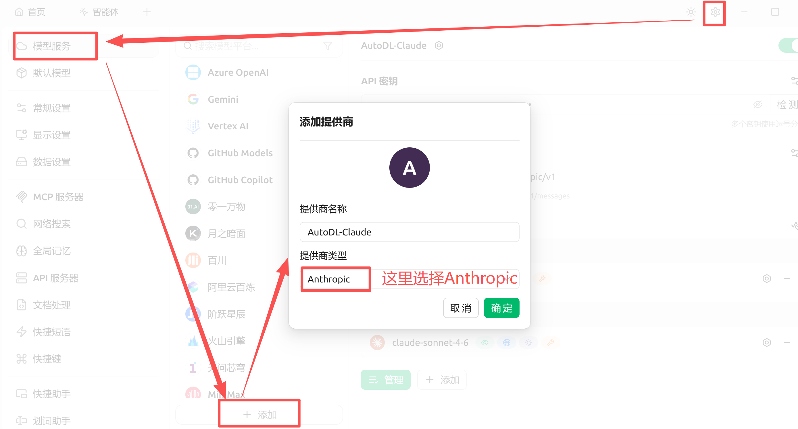
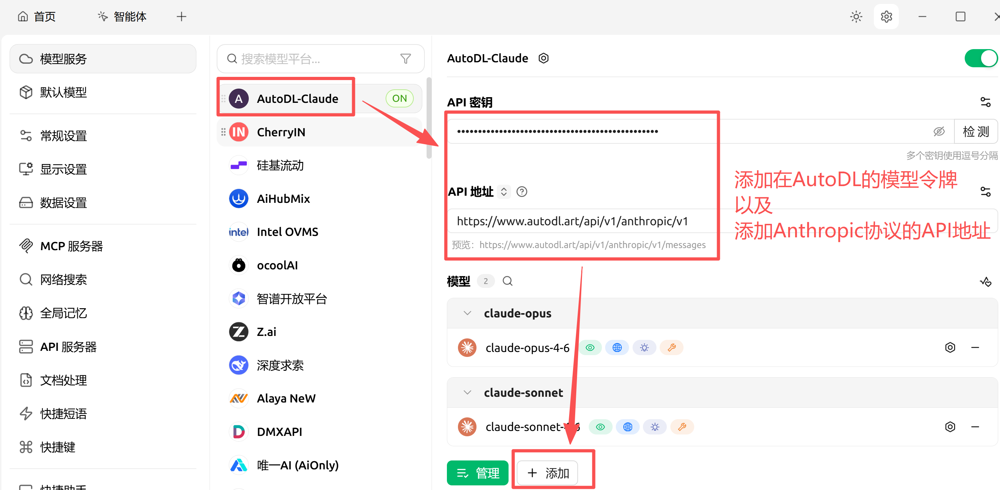
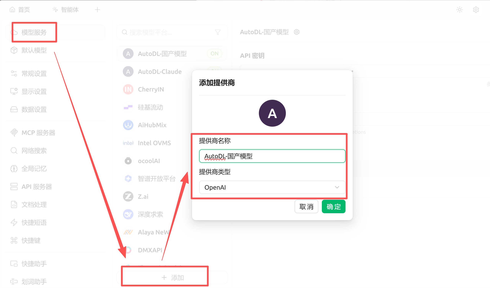
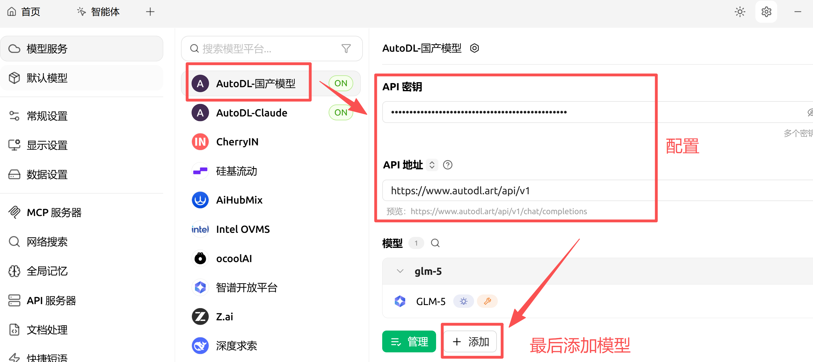
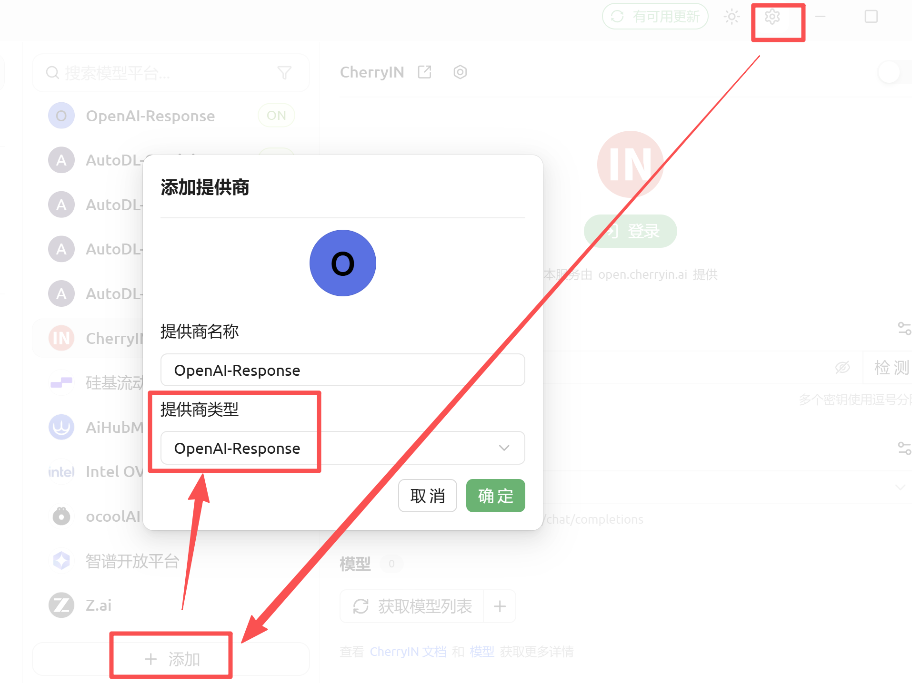
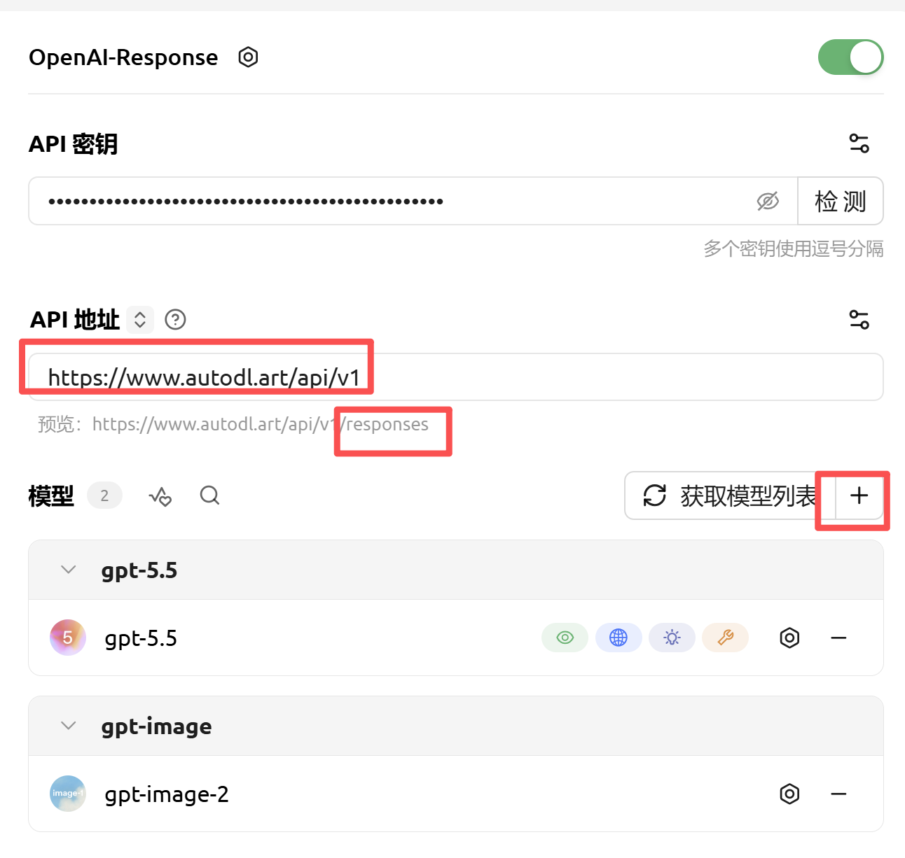
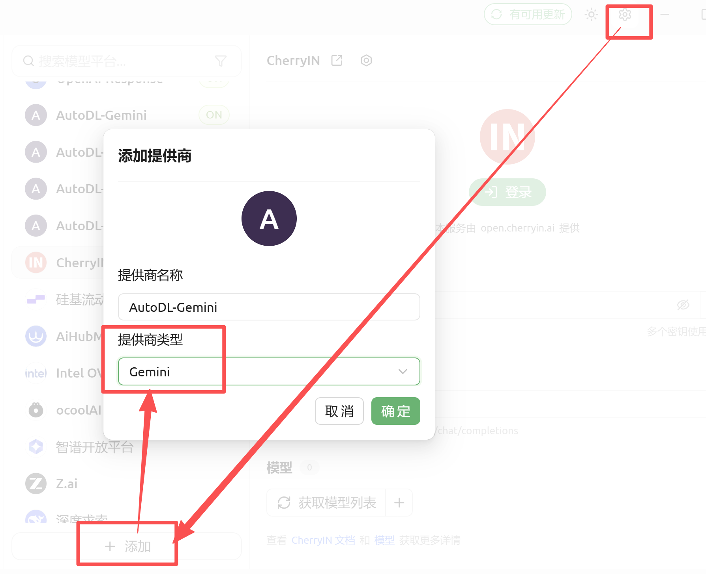
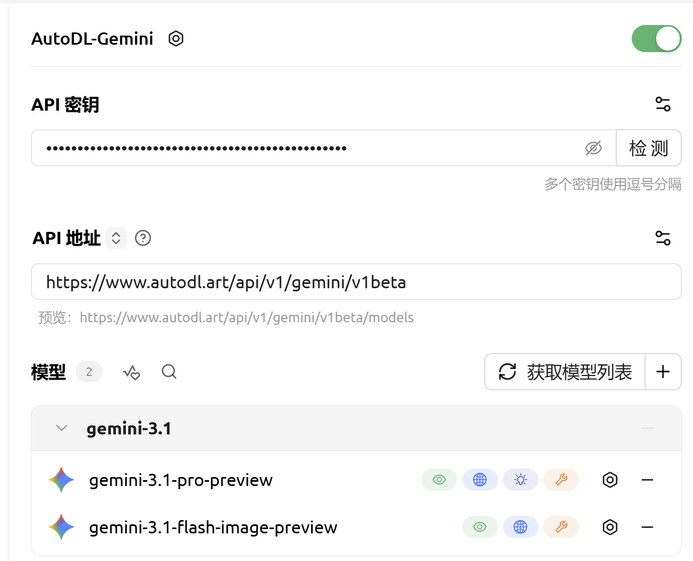

Cherry Studio 是一款支持多种大模型服务的桌面客户端。通过配置 AutoDL 的第三方 Token，你可以在 Cherry Studio 中调用 AutoDL 提供的大模型 API。

## 前置准备

1. 安装并打开 [Cherry Studio](https://cherry-ai.com/)。
2. 前往「大模型」->「[令牌管理](https://www.autodl.art/large-model/tokens)」创建并复制 `API_KEY`。
3. 前往「[大模型](https://www.autodl.art/large-model/market)」页面复制要使用的模型名称。

<Note>
下方配置中的 `<你的API_KEY>` 和 `<模型名称>` 需要替换为 AutoDL 页面中的实际值。
</Note>

## 配置 Claude 系列模型

### Step 1：新增AutoDL供应商

打开 Cherry Studio，进入「设置」->「模型服务」，点击「添加」或选择 Anthropic 服务商。

### Step 2：配置AutoDL供应商的参数

这里要填写的Anthropic协议的API地址为：https://www.autodl.art/api/v1/anthropic/v1

## 配置国产模型

这里国产语言模型主要指兼容OpenAI Chat Complete接口的模型，包含：智谱系列，DeepSeek系列，MiniMax系列，Kimi系列等

### Step 1：新增AutoDL供应商
由于多数国产大模型都使用了兼容OpenAI的协议，因此在创建供应商时请选择模型提供商类型为：OpenAI

### Step 2：配置AutoDL供应商的参数

API地址请填写：https://www.autodl.art/api/v1
添加模型，比如：GLM-5，您也可以一次性添加多个模型，使用时切换选择即可

## 配置OpenAI系列模型

建议在使用OpenAI系列模型时，使用OpenAI最新的Reponses形式的协议，适应多模态模型，完整API地址为:https://www.autodl.art/api/v1/responses，
gpt-5.4，gpt-5.5，gpt-image-2均兼容此接口

### Step 1：新增AutoDL供应商
选择提供商类型：OpenAI-Response

### Step 2：配置AutoDL供应商的参数

API地址请填写：https://www.autodl.art/api/v1，
添加模型，比如：gpt-5.5

## 配置Gemini系列模型

### Step 1：新增AutoDL供应商

选择提供商类型：Gemini

### Step 2：配置AutoDL供应商的参数

API地址请填写：https://www.autodl.art/api/v1/gemini/v1beta，
添加模型，比如：gemini-3.1-pro-preview

