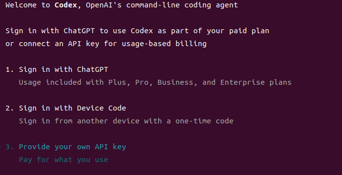
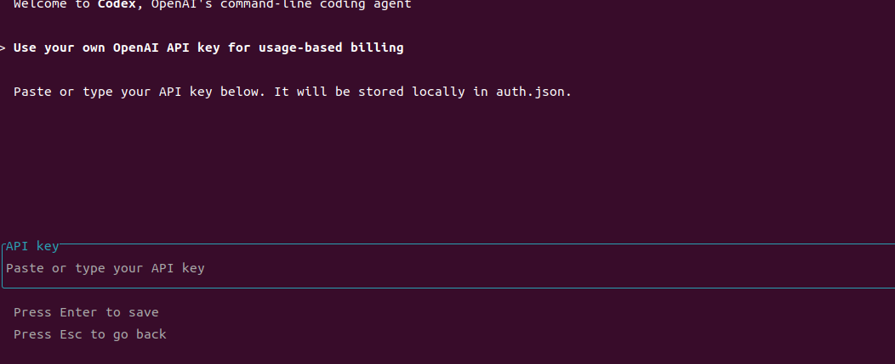

Codex 是 OpenAI 提供的命令行编程助手。通过配置 AutoDL 的第三方 Token，你可以在本地终端直接使用 Codex。

## 前置准备

1. 安装 Node.js 和 npm。
2. 安装 Codex：

```Shell
npm install -g @openai/codex
```

3. 前往「大模型」->「[令牌管理](https://www.autodl.art/large-model/tokens)」创建并复制 `API_KEY`。

<Note>
下方命令中的 `<你的API_KEY>` 需要替换为在 AutoDL 令牌管理页面获取的 Token。
</Note>

## CC Switch

推荐使用 [CC Switch](/model/tool/ccswitch) 统一管理 Codex、Claude Code 等工具的环境变量。

## 配置 Codex

### 环境准备 (配置 API 代理地址)

请在启动 Codex 之前，先在终端执行以下命令来覆盖默认的 API 地址：

```Shell
# 设置自定义 API 基础路径
export OPENAI_BASE_URL="https://www.autodl.art/api/v1"
```
<Tip>
建议将此命令添加到你的 shell 配置文件（如 ~/.bashrc 或 ~/.zshrc ）中，以便持久生效。
</Tip>

### 启动 Codex

在终端中输入以下命令启动程序：

```Shell
codex
```

### 身份验证与 API Key 输入

启动后，你将看到登录选项界面。请按照以下步骤操作：

1. 选择登录方式：使用键盘方向键或数字键选择 **3. Provide your own API key** 。



2. 输入 Key：在弹出的输入框中粘贴或输入你的API Key。



输入完成后按下 Enter 键保存。

## 启动 Codex

完成配置后，在任意项目目录运行：

```Shell
codex
```

如果 Codex 正常启动，并且能够读取 AutoDL 的接口地址和令牌，说明配置成功。

可以发送一句“您好”测试，并观察[数据看板](https://www.autodl.art/large-model/dashboard)消耗。

## 更多资源

高级配置：如果你需要调整模型参数、超时时间或日志设置，请参考官方文档：[Codex 高级配置指南](https://learn.chatgpt.com/docs/config-file/config-advanced)

返回/取消：在输入 Key 的界面，可以按 Esc 键返回主菜单。