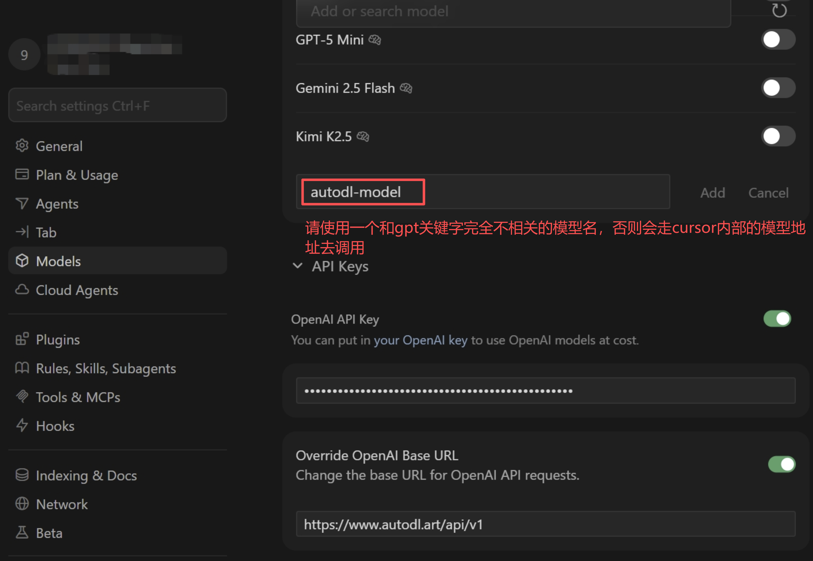
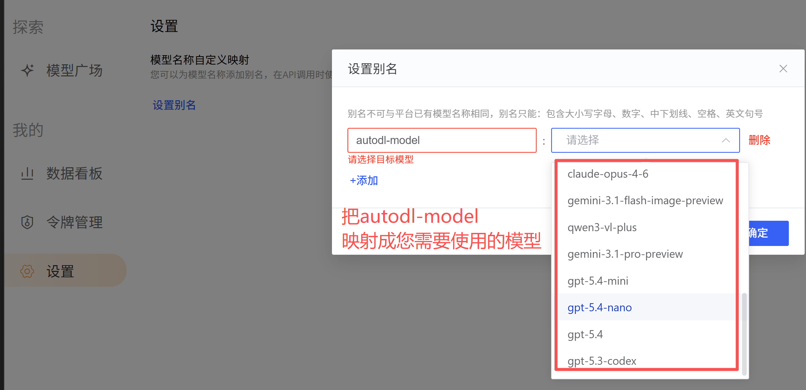

Cursor 是一款基于 AI 的代码编辑器。通过配置 AutoDL 的第三方 Token，你可以在 Cursor 中使用 AutoDL 提供的大模型 API。

<Tip>由于 Cursor 产品限制，免费版仅支持Auto模式，不支持调用自定义模型。如需使用自定义模型请升级至Cursor Pro 及以上套餐</Tip>

## 前置准备

1. 安装并打开 [Cursor](https://www.cursor.com/)。
2. 前往「大模型」->「[令牌管理](https://www.autodl.art/large-model/tokens)」创建并复制 `API_KEY`。

## 配置步骤

### Step 1：打开模型设置

打开 Cursor，点击右上角设置图标，选择 **Settings**，然后进入 **Models** 设置页面。

### Step 2：配置 AutoDL Token

在使用Cursor模型时，请按以下截图中所示配置：模型名称、API Key和Base URL。这里需要注意的是如果您使用的模型名称与Cursor中已经存在的模型名关键字有重合（模糊匹配），那么Cursor会走自己内置模型对应的URL地址来调用模型。比如您添加的模型名为：gpt 5.4，可能会被匹配为内置的GPT-5。因此建议自定义模型名时请填写和Cursor默认模型完全无关联的模型名，比如autodl-model，这里使用autodl-model模型后，请在 www.AutoDL.art 「大模型」 → [「设置页面」](https://www.autodl.art/large-model/settings)添加一个模型名称映射，将autodl-model映射为AutoDL中存在的模型，从而绕开Cursor的内部模型名模糊匹配的逻辑。

### Step 3：启用模型

在模型列表中勾选刚刚添加的模型，然后返回 Cursor 聊天面板，在模型选择器中选择该模型。

