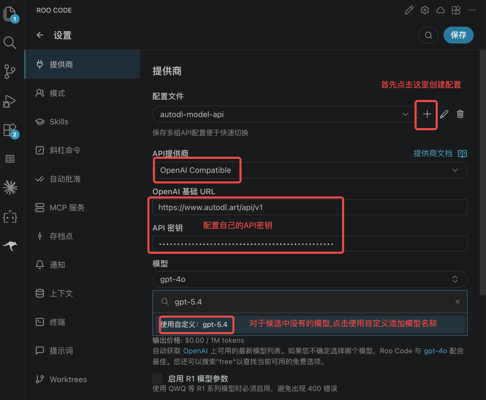

Trae 是一款 AI 编程工具。通过配置 AutoDL 的第三方 Token，你可以在 Trae 中使用 AutoDL 提供的大模型 API。

<Tip>
原生Trae不支持配置外部模型，可通过安装插件的方式使用外部模型厂商的API。
</Tip>

## 前置准备

1. 安装并打开 [Trae](https://www.trae.ai/)。
2. 前往「大模型」->「[令牌管理](https://www.autodl.art/large-model/tokens)」创建并复制 `API_KEY`。
3. 前往「[大模型](https://www.autodl.art/large-model/market)」页面复制要使用的模型名称。

<Note>
下方配置中的 `<你的API_KEY>` 和 `<模型名称>` 需要替换为 AutoDL 页面中的实际值。
</Note>

## 配置步骤

### Step 1：打开模型设置

打开 Trae，进入设置页面，找到 **AI**、**Models** 或 **模型**相关配置。

不同版本的 Trae 菜单名称可能略有差异，请优先查找模型提供商或自定义模型入口。

### Step 2：配置模型 API

在配置【API提供商】时，请选择【OpenAI Compatible】类型。如果您希望使用Claude系列模型，请仍然选择【OpenAI Compatible】类型，然后使用我们为Claude模型提供的OpenAI的端点URL地址，即用OpenAI协议使用Claude模型。

<Tip>
配置下方还有上下文长度的配置，如果出现异常可以重新设置一下这个参数，一些情况下会因为改参数不匹配而报错
</Tip>

### Step 3：启用模型

保存配置后，将刚添加的模型设为当前模型，然后打开 Trae 的对话面板或代码辅助功能进行测试。